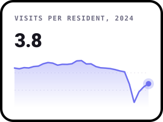
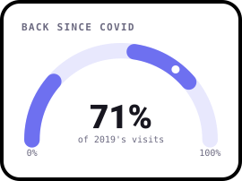
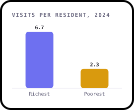
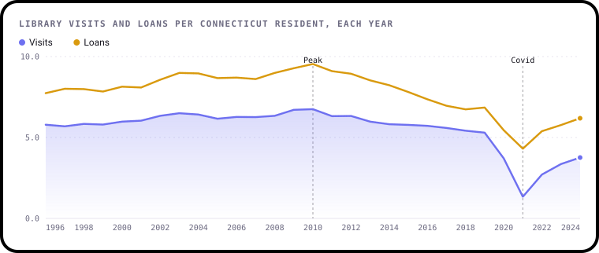
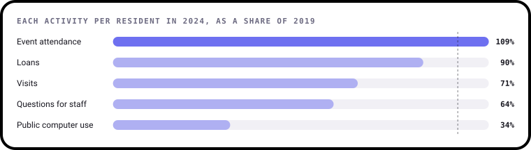
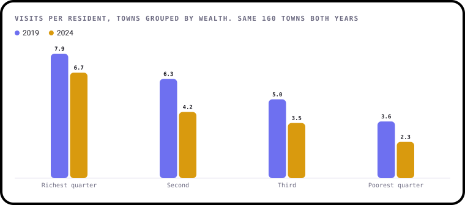

# Are People Still Going to the Library?

**An analysis of 29 years of Connecticut's public library statistics, 1996 to 2024: what people stopped doing, what came back after Covid, and which towns were left behind.**

[](https://github.com/ShazMoghaddam/Public-Libraries-Analysis/actions/workflows/checks.yml)
[](https://pypi.org/project/bezel-charts/)
[](LICENSE)

Every public library in Connecticut reports what it did each year: visits, loans, events, questions and money. Put together
and adjusted for population, they show libraries changing long before the pandemic, and a recovery that has left poorer
towns further behind.

<p align="center">
  
  
  
</p>

> **Every chart here is drawn with [bezel-charts](https://pypi.org/project/bezel-charts/), an open-source Python library
> created by Shaz Moghaddam, the author of this project.** It turns pandas data into clean, self-contained SVG charts.

---

## Key findings

<!-- key-findings:start -->
### Visits were falling long before Covid

Connecticut residents made 6.75 library visits each in 2010. By 2019, before the pandemic, that was down to
5.30, a fall of 21%. Borrowing fell even faster.



### Events came back. Computers didn't

Per resident, event attendance in 2024 was **109%** of its 2019 level, and borrowing 90%. But visits
were only 71% and public computer use 34%.



### Richer towns' libraries bounced back. Poorer towns' didn't

In 2019, people in the richest quarter of towns visited their library 2.2 times as often as people in the poorest
quarter. By 2024 it was **3.0 times**, because rich towns got back to 85% of their old visits and poor
towns only 63%.



### The first version's 99.5% score was the answer, copied in

The original model predicted visits per resident, using a column it had made by dividing visits by population. That's the
same number. That column alone scores 99.5%. A fair test, on a later year, is in finding 7.
<!-- key-findings:end -->

**[Read all seven findings, and what the data can't tell you →](findings/README.md)**

| # | Finding | |
|---|---|---|
| 1 | Visits were falling long before Covid | Twenty years of visits, loans and events per resident |
| 2 | Events came back after Covid. Computers didn't | What people returned for, and what they didn't |
| 3 | Richer towns' libraries bounced back. Poorer towns' didn't | The gap between rich and poor towns, before and after |
| 4 | Towns that spend more on their library see more use | Spending and visits in every town |
| 5 | Each resident pays less, each visit costs more | Library spending after inflation |
| 6 | The first version's 99.5% score was the answer, copied in | What went wrong with the original model |
| 7 | Wealth and spending explain more than half the difference between towns | A fair test against simple guesses |

---

## Run it yourself

You'll need Python 3.11 or newer. The data is small enough to live in the repo, so there's nothing to download.

```sh
git clone https://github.com/ShazMoghaddam/Public-Libraries-Analysis.git
cd Public-Libraries-Analysis
python3 -m venv .venv && source .venv/bin/activate
pip install -r requirements-dev.txt

python data/prepare.py      # tidy data from the raw files
python findings/build.py    # charts and report
pytest                      # checks the data and the numbers
```

Or open [`notebooks/public_libraries_analysis.ipynb`](notebooks/public_libraries_analysis.ipynb) for the same analysis with the working shown.

## What's in the repo

```
├── data/
│   ├── raw/                  The State Library's download and the US inflation index
│   ├── prepare.py            Raw files to the tidy ones below
│   ├── libraries.csv         One row per library and year, with renamed libraries joined up
│   ├── prices.csv            Inflation by fiscal year, to turn money into 2024 dollars
│   └── sources.json          Where everything came from
├── findings/
│   ├── analysis.py           Every calculation, as small functions
│   ├── charts.py             Every chart
│   ├── build.py              Writes the charts and the report
│   └── README.md             The full report
├── notebooks/public_libraries_analysis.ipynb
├── charts/                   The SVG charts
├── tests/                    Checks on the data and the findings
└── .github/                  Automatic checks and dependency updates
```

## Data

The figures come from [Public Libraries](https://data.ct.gov/Government/Public-Libraries/kf75-36tt), published by the Connecticut State
Library on the state's open data portal and listed on [Data.gov](https://catalog.data.gov/dataset/public-libraries). It's in the public domain. The copy
here was downloaded in November 2026 and covers fiscal years 1996 to 2024. Prices are adjusted with the
[Consumer Price Index](https://www.bls.gov/cpi/) (CPI-U) from the US Bureau of Labor Statistics, also public domain.
[`data/sources.json`](data/sources.json) has the details.

Code and content in this repo are [MIT licensed](LICENSE).

---

Shaz Moghaddam, https://shazmoghaddam.github.io/, London
