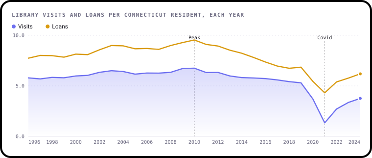
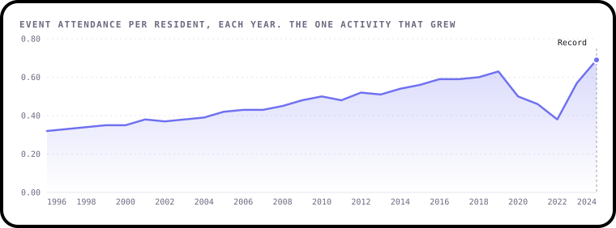
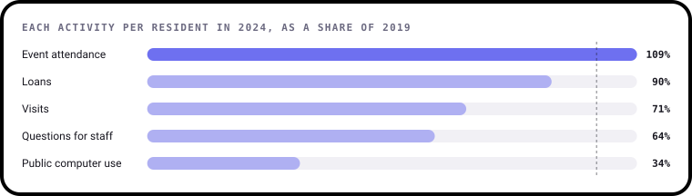
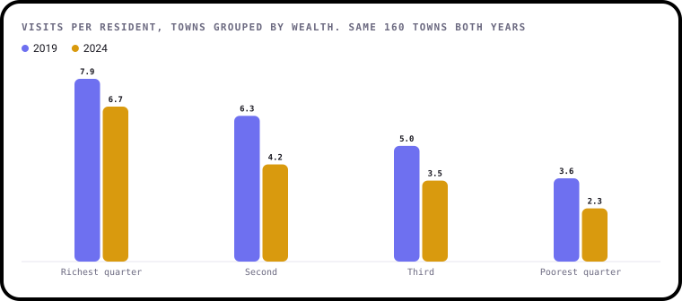
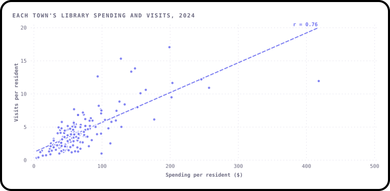
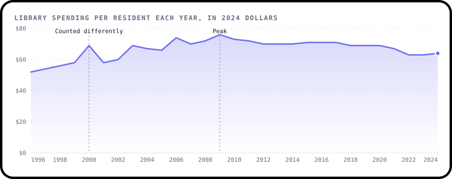
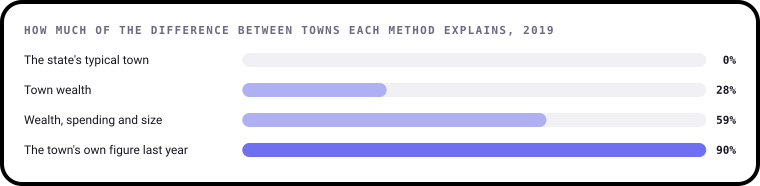

# Findings

What 29 years of Connecticut's public library statistics can and can't tell you. This page is written by
[`build.py`](build.py), so every number comes straight from the data.

The data covers 193 libraries in 165 towns, from 1996 to 2024. Years are the libraries' fiscal years, so
2024 means July 2023 to June 2024. Most figures are **per resident**: every library in a town is added up and
divided by the town's population. That keeps years comparable when a library didn't report, and stops a small branch
being compared with a whole city. Money is in 2024 dollars, adjusted with the US Consumer Price Index.

## 1. Visits were falling long before Covid

Connecticut residents made 5.8 library visits each in 1996, rising to a peak of 6.75 in 2010. Then visits
fell almost every year, to 5.30 in 2019, down 21%, before the pandemic began. Loans followed the same
path, peaking at 9.5 per resident in 2010 and falling 28% by 2019.

Other everyday uses fell too. Public computer use peaked at 1.9 sessions per resident in 2006, and questions for staff peaked at
1.2. The data doesn't say why. Loans count every format, including e-books, so the fall isn't only print.

The one thing that grew was events. Attendance at talks, classes, story times and other events went from 0.32 per
resident in 1996 to 0.63 in 2019, 2.0 times as many.

## 2. Events came back after Covid. Computers didn't

In 2021, the first full year of the pandemic, visits fell to 1.34 per resident, 75% below 2019. By 2024
they were back to 3.76.

The comeback depends on what people came for. Event attendance per resident in 2024 was 109% of its 2019 level,
a new record at 0.69. Borrowing was 90%. But visits were 71%, questions for staff
64% and public computer use only 34%.

So people still borrow, and come in for events, but fewer drop in, and far fewer use the computers. One likely reason is
that e-books can be borrowed without going in at all.

## 3. Richer towns' libraries bounced back. Poorer towns' didn't

Connecticut ranks all 169 of its towns by wealth each year, using property values and income per person. Splitting the
160 towns with figures for both 2019 and 2024 into four equal groups by wealth shows a large gap. In 2019, people in the
richest quarter made 7.9 visits each and people in the poorest quarter 3.6. That's 2.2 times as many.

After Covid the gap grew. Rich towns got back to 85% of their 2019 visits and poor towns only 63%, so by
2024 it was 6.7 visits against 2.3, **3.0 times** as many. The towns are the same in both years, so
this isn't caused by which libraries reported.

## 4. Towns that spend more on their library see more use

In 2024, the richest quarter of towns spent $115 per resident on their libraries, and the poorest quarter
$47. Across all 162 towns, spending per resident and visits per resident go together closely, with a correlation of
0.76 (1 would be a perfect straight line).

This shows a link, not a cause. Spending could bring people in, with longer hours and more staff, or busy libraries could
win bigger budgets. Both are likely. Town taxes paid for 82% of library income in 2024, so richer towns can simply afford more.

## 5. Each resident pays less, each visit costs more

After inflation, library spending rose from $52 per resident in 1996 to a peak of $76 in 2009. Since
then it has drifted down to $64 in 2024, 15% lower.

Visits fell faster than spending, so each visit now costs more: $11 in 2010, $13 in 2019 and $17 in
2024. That's not waste. Visits are only one part of what a library does, and loans and events don't need one.
Spending in 2000 jumps and falls back the next year at many large libraries, which looks like a change in what was counted
rather than real money.

## 6. The first version's 99.5% score was the answer, copied in

The first version of this project trained a model to predict each library's visits per resident and reported a score
(R²) of 99.5%. But one of its inputs was a column it had made itself, visits divided by population. That's the same
thing it was predicting, and the two columns are almost identical (a correlation of 0.999). That one column on its
own scores 99.5%.

Three more things went wrong:

- **It printed the wrong error.** The number labelled "RMSE", 0.0725, was the squared error. The real figure is
  0.27 visits per resident.
- **It quietly dropped 44% of the data.** Removing every row with a blank left 2,965 rows and no year before
  2005, because public computers weren't counted until then.
- **Its full score isn't even stable.** Its 25 inputs overlap so much that the same code scores differently on different
  versions of scikit-learn.

## 7. Wealth and spending explain more than half the difference between towns

A fairer question is how well you can predict a town's library use without counting it. Here each method learns from 2010
to 2017 (1,307 town-years) and is tested on 2019, which it hasn't seen. Towns made 5.8 visits per resident on average.

Guessing the state's typical town is off by 2.6 visits per resident. Knowing a town's wealth explains 28% of
the differences between towns. Adding its library spending per resident and its size explains 59%, and gets
within 1.7 visits on average. The best guess by far is the town's own figure from the year before, which explains 90%:
library use changes slowly, and each town's habits run deep.

## What this data can't tell you

- **Why use fell.** The data shows patterns, not causes. E-books, phones and opening hours are all possible, and none is
  measured here.
- **Who uses libraries.** There's nothing about age, income or background of the people walking in, only town totals.
- **Whether fewer people have a card.** Registered borrowers fell from 59 per 100 residents in 2008 to 32 in
  2024, but libraries sometimes clear out old records, so it's not clear how much of that is real.
- **Anything outside Connecticut.** This is one state's data, despite the first version calling it national.

## About the data

The Connecticut State Library publishes these figures each year for every public library in the state. A few things
needed fixing before they could be used:

- **Libraries change names.** 219 names in the file are really 193 libraries, for example "Glastonbury - East" and
  "Glastonbury, East". They're joined up in [`data/prepare.py`](../data/prepare.py).
- **2024 is incomplete.** 10 libraries that reported in 2023 are missing, including Norwalk, so totals for 2024
  are too low. Per-resident figures leave those towns out instead.
- **Materials spending for 2024 isn't comparable.** The typical library spent 9% of its budget on books
  and other materials in 2023 and 1.5% in 2024, which means it was counted differently. It's left blank.
- **Branch libraries have no population** of their own. 464 rows have none, which is why figures are worked out
  by town.
- **Closed branches reported zeros** during Covid. Those rows are treated as blank, not as a year with no use.

## How it was worked out

1. [`data/prepare.py`](../data/prepare.py) tidies the download, joins renamed libraries, matches each library to its town and builds the
   inflation index.
2. [`analysis.py`](analysis.py) holds every calculation as a small, tested function.
3. [`charts.py`](charts.py) draws each chart with [bezel-charts](https://pypi.org/project/bezel-charts/).
4. [`notebooks/public_libraries_analysis.ipynb`](../notebooks/public_libraries_analysis.ipynb) walks through the same steps with the working shown.
